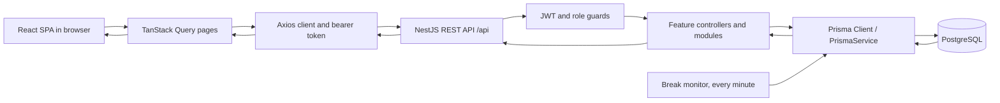
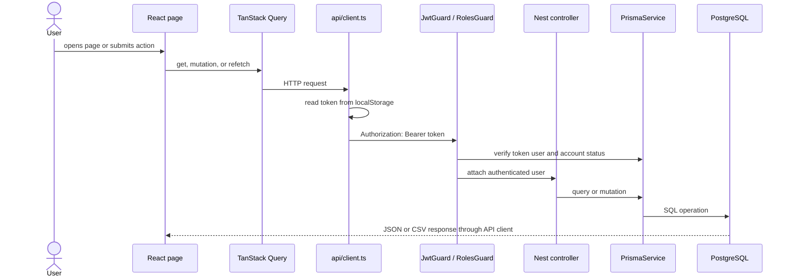
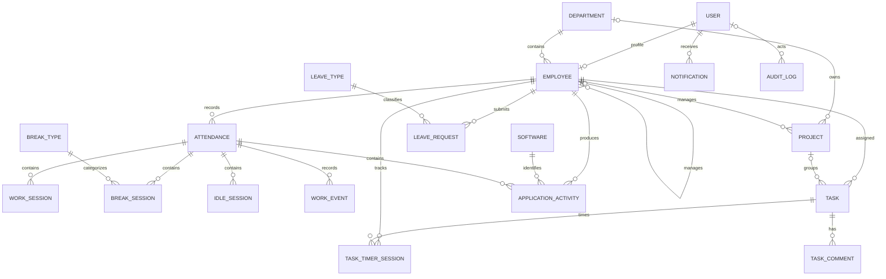
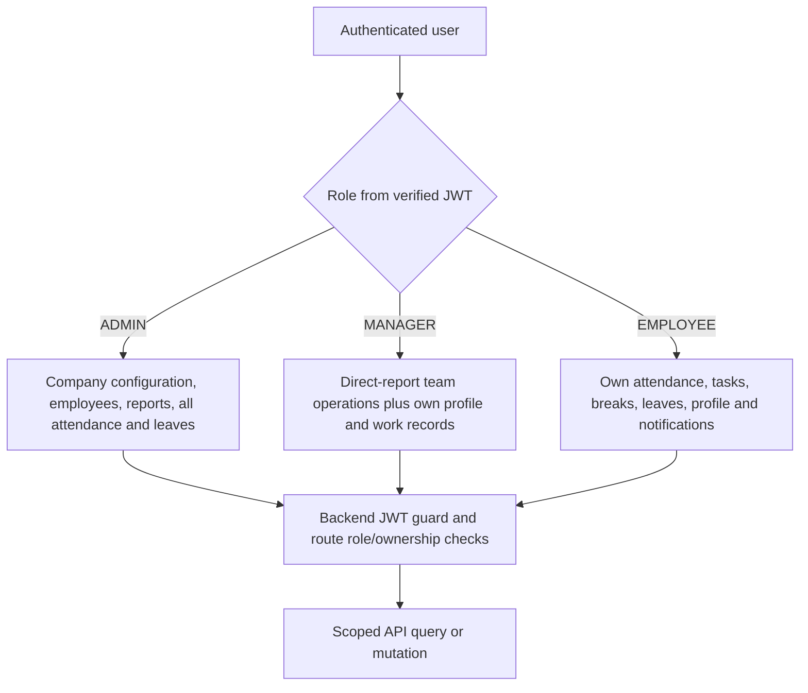
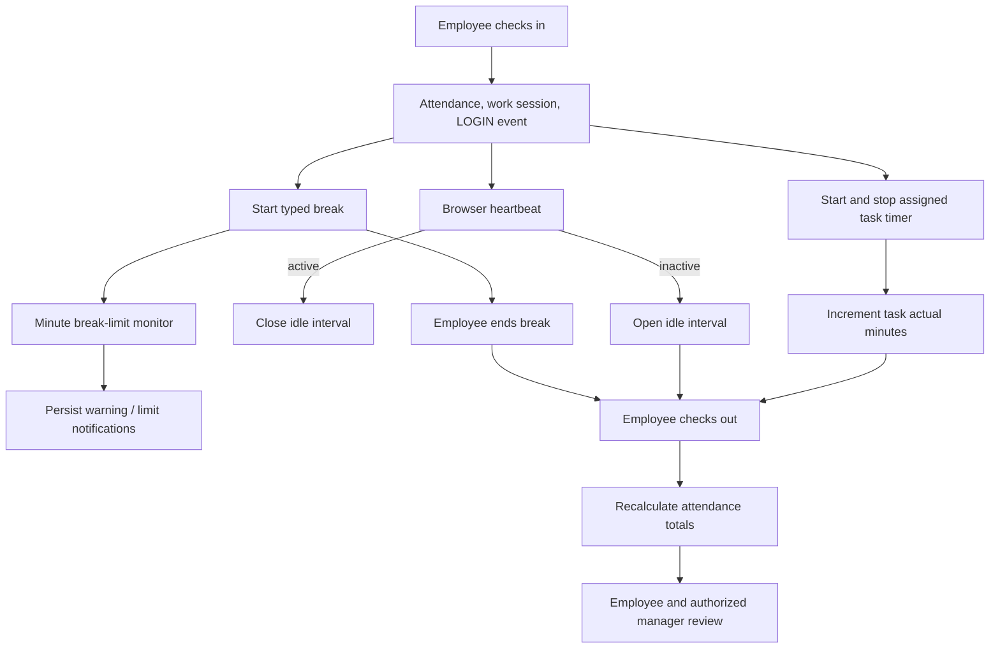

# Employee Work Management System — Complete Project Documentation

**Repository:** `employee-work-management`  
**Project type:** Web-based employee operations and work tracking system  
**Analysis basis:** Source, package manifests and lockfiles, Prisma schema, environment examples, Docker files, tests, and the existing README.  
**Documentation status:** Source review completed for the tracked application areas listed in the coverage checklist. Runtime deployment, a live database, and external integrations were not available for verification.

## 1. Executive Summary

This project is a three-role web application for managing employee records, daily attendance, break and idle intervals, task assignment and timers, leave requests, projects, company settings, notifications, and management reports. It uses a React/TypeScript single-page frontend, a NestJS/TypeScript REST API, PostgreSQL, and Prisma.

The strongest implemented workflows are account login, role-based pages, attendance check-in/out and calculations, task assignment/timers, leave submission and review, notifications, and manager/admin reporting. The schema contains additional tracking concepts, including software allowlists and application activity, but no runtime code records application activity. The repository also has no checked-in Prisma migration beyond the migration provider lock file, which is a material setup and deployment gap.

## 2. Purpose, Motivation, and Problems Addressed

The source and README indicate a goal of bringing common employee operations into one place. The application can replace separate manual processes for recording attendance, tracking break/idle intervals, assigning tasks, requesting leave, and preparing basic management reports. For example, an employee checks in with a work mode, records breaks and tasks, and checks out; a manager can review team attendance, tasks, and leave requests from role-specific pages.

The product may reduce spreadsheet duplication and make records more consistent by persisting them in a relational database. The repository does not contain business requirements, customer discovery, or deployment evidence, so the exact organizational motivation and target market are inferred from the implemented modules and existing README rather than independently verified.

### Intended users

| Role | Verified responsibilities |
|---|---|
| `ADMIN` | Maintain employee records and company configuration; manage departments, leave types, holidays, break types, software entries, tasks, leave decisions, reporting, and audit-log viewing. |
| `MANAGER` | View direct reports; review team attendance, tasks, leaves, and reports; create and manage permitted team tasks and manager-owned projects; also use personal attendance/task/leave workflows where an employee profile exists. |
| `EMPLOYEE` | Use personal profile, attendance, break and idle tracking, tasks and timers, leave requests, and notifications. |

The `Role` enum in `backend/prisma/schema.prisma` defines these three roles. Managers are scoped primarily to direct reports (`Employee.managerId`) in the employee, task, attendance, report, and leave code paths.

## 3. Feature Status

| Area | Status from source review |
|---|---|
| Login, JWT issuance, current-user lookup, profile update | Implemented. Account creation is performed through admin employee APIs; there is no public sign-up page. |
| Role-based frontend navigation and API guards | Implemented, with route-specific role rules described below. |
| Attendance check-in/out, timezone-aware day and schedule, summaries/history | Implemented. The configured working-day list is enforced. The `Holiday` table is not consulted by check-in logic. |
| Break types, break sessions, notifications for long breaks | Implemented. The scheduled monitor notifies; it does not end a break. |
| Idle heartbeats | Implemented as browser-originated active/inactive signals. This does not prove what work is happening. |
| Tasks, assignment, status/priority changes, task timers | Implemented. Task comments are represented in schema and returned with task lists, but no comment-write API was found. |
| Projects | Implemented for listing, create/update by admin/manager, and admin-only delete. Manager operations are restricted to manager-owned projects. |
| Leave request and review | Implemented, with notifications on submission and review. Managers are restricted to direct-report requests. |
| Reports and attendance CSV | Implemented for admin and manager with manager team scoping. |
| Departments, leave types, holidays, settings, software, audit-log reads | Backend APIs exist; admin management UI includes company management controls. |
| Software/application activity | Partial/data-model only. `Software` and `ApplicationActivity` models exist and software allowlist CRUD exists; no `ApplicationActivity` create/read workflow or desktop capture agent was found. |
| Email, push, realtime notification delivery | Not found. Notifications are database-backed in-app records, polled by the frontend. |
| Migrations and automated database bootstrap | Not complete in repository: no migration directory with migration SQL exists. |
| Tests | Minimal: one Jest file tests time-minute and arithmetic examples. No API, integration, authorization, UI, or end-to-end tests were found. |

## 4. Technology Stack

### Frontend

| Technology | Declared version / use |
|---|---|
| React and React DOM | `^19.1.1`; UI components and pages. |
| TypeScript | `^5.9.2`; strict frontend compilation. |
| Vite | `^7.1.4`; dev server and production bundler, with `@vitejs/plugin-react`. |
| React Router | `^7.8.2`; browser routes in `frontend/src/App.tsx`. |
| TanStack Query | `^5.87.1`; server-state fetching, polling, caching, invalidation; default query stale time is 10 seconds and one retry. |
| Axios | `^1.11.0`; shared HTTP client in `frontend/src/api/client.ts`. |
| CSS | Project-owned CSS files; no CSS framework is declared. |
| Recharts | `^3.1.2`; charts on dashboard/report/time pages. |
| Lucide React | `^0.468.0`; icons. |
| React Hook Form, Zod, resolver | Declared dependencies, but no `useForm`, `zodResolver`, or Zod form schema use was found in `frontend/src`. Most forms use local React state and native inputs. |

There is no separate global state framework. Authentication is reconstructed by `useAuth()` from the local-storage token and `/auth/me`; page data is generally fetched through TanStack Query. `frontend/src/components` contains shared `Layout`, `DataTable`, `FilterBar`, `FormModal`, `ConfirmDialog`, `Stat`, and `StatusBadge` components.

### Backend

| Technology | Declared version / use |
|---|---|
| Node.js | Docker build/runtime image uses Node 22 Alpine. A separate minimum local Node version is not declared. |
| NestJS | `@nestjs/*` packages are declared at `^11.0.0`; modular HTTP API using controllers and module classes. |
| TypeScript | Backend `typescript` `^5.9.2`, strict mode and decorator metadata. |
| REST / Express adapter | `@nestjs/platform-express`; global `/api` prefix. |
| Prisma | Prisma CLI and client `^6.16.0`; `PrismaService` connects on module init. |
| Authentication | `@nestjs/jwt`, `bcryptjs`; bearer JWT and role guards. |
| Validation | `class-validator`, `class-transformer`, global Nest `ValidationPipe`. DTO validation is used on some endpoints; several handlers accept `any` and validate manually or incompletely. |
| Security headers | Helmet middleware. CORS origin is configured from `CORS_ORIGIN`, with a development fallback. |
| Scheduling | `@nestjs/schedule` 5.0.1 in backend; `BreakMonitorService` runs every minute. Root `package.json` separately declares `@nestjs/schedule` `^12.0.2` but contains no project scripts. |

The backend is organized mostly as feature modules and controllers. Business/data logic is commonly implemented directly inside controller classes with `PrismaService`; employee CRUD is separated into `EmployeesService`. There is no repository abstraction layer or standalone service layer across every module.

### Database

PostgreSQL is the Prisma datasource. The Docker Compose file specifies PostgreSQL 16 Alpine. Exact server/client versions outside the container are not verified. Prisma schema uses UUID string primary keys, enum columns, relation constraints, unique keys, and selected indexes. See the model table in section 12.

### Development and deployment tools

- Git repository metadata is present; Git is the apparent version-control system.
- npm lockfiles are present at root, frontend, and backend. Use `npm ci` in each package for lockfile-based installation.
- Docker Compose starts only PostgreSQL. Separate Dockerfiles build the frontend into Nginx and compile the backend into a Node image, but no application services are wired into Compose.
- Vite and Nest CLI provide local development servers.
- Prisma Studio is available through the backend package script.
- Jest is declared for backend tests; no frontend test runner is configured.
- No CI workflow, production orchestration, logging vendor, monitoring service, or database backup setup was found in the repository.

## 5. System Architecture



### Application entry points

- Frontend: `frontend/index.html` loads `frontend/src/main.tsx`, which renders `App` under React Strict Mode. `App.tsx` installs React Router and a shared Query Client, then defines login, role-protected routes, and a fallback to `/login`.
- Backend: `backend/src/main.ts` calls `NestFactory.create(AppModule)`, sets `/api`, Helmet, configured CORS, global request validation, then listens on `PORT` or the development default.
- Database: Nest modules inject `PrismaService` (`backend/src/prisma.service.ts`), which extends Prisma Client and connects/disconnects with Nest lifecycle hooks.

### Frontend request flow



The Axios base URL is `VITE_API_URL` or the local API default. The backend's global prefix means paths such as `/attendance/today` resolve under `/api/attendance/today`. Most pages use query keys, periodic refetching for live-ish data, and invalidation after mutations. This is polling rather than WebSocket or server-sent events.

## 6. Repository and File Map

| Path | Responsibility |
|---|---|
| `frontend/src/main.tsx`, `App.tsx` | Browser startup, global CSS, route table, query provider, route guards. |
| `frontend/src/api/client.ts`, `hooks/useAuth.ts` | Axios token injection and login-session restoration. |
| `frontend/src/components/` | Shared layout, modal, table, filter, confirmation, stat, and status components. |
| `frontend/src/pages/` | Admin, manager, and employee feature pages; page-specific CSS sits beside pages. |
| `frontend/src/types/index.ts`, `utils/time.ts` | Frontend shared records and time formatting helpers. `types/index.old.ts` is an unused-looking legacy file; its build/runtime role was not verified. |
| `backend/src/main.ts`, `app.module.ts` | Nest bootstrap, global configuration, module composition, JWT configuration. |
| `backend/src/common/auth.ts`, `common/time.ts` | Bearer-token and role guards; timezone/date and interval helpers. |
| `backend/src/auth/`, `employees/`, `attendance/`, `leaves/`, `tasks/`, `projects/`, `breaks/`, `idle-tracking/`, `work-sessions/`, `task-timers/` | Feature-specific REST controllers and data operations. |
| `backend/src/admin.module.ts` | Admin and management APIs for configuration, notifications, reports, and audit-log reads. |
| `backend/prisma/schema.prisma`, `seed.ts` | Database model and development seed script. The `migrations/` folder contains only `migration_lock.toml`. |
| `backend/test/business.spec.ts` | Small time arithmetic unit tests. |
| `frontend/package.json`, `backend/package.json`, lockfiles, tsconfigs, Vite/Nest config | Dependencies and build/development configuration. |
| `docker-compose.yml`, `frontend/Dockerfile`, `backend/Dockerfile` | Database-only local Compose and separate image build recipes. |
| `README.md`, `README_v1.md` | Existing project overview and setup/workflow narrative; README itself cautions readers to verify intent against actual implementation. |

The source tree includes `backend/src/admin.module copy.ts`, an unreferenced duplicate-looking controller file. `AppModule` imports `AdminModule` and `EmployeesModule`; only the latter registers its `EmployeesController`. The copy file is included by the TypeScript `src` include pattern but is not registered in `AppModule`.

## 7. Frontend Architecture and Pages

`Protected` in `App.tsx` calls `useAuth`; while loading it renders a loading message, unauthenticated users are sent to `/login`, and role mismatches are redirected to that user's dashboard. This is navigation control only; server guards are the API authorization boundary.

| Role | Routes and primary pages |
|---|---|
| Employee | `/employee/dashboard` (`EmployeeDashboard`), `/profile`, `/attendance`, `/tasks`, `/time-tracking`, `/leaves` (`Leaves`), `/notifications`. |
| Manager | `/manager/dashboard`, `/profile`, `/team`, `/attendance`, `/time-management`, `/tasks`, `/leaves`, `/reports`, `/notifications`. |
| Admin | `/admin/dashboard`, `/employees`, `/attendance`, `/tasks`, `/projects` (`BasicPage`), `/leaves`, `/holidays` (`BasicPage`), `/reports`, `/management`, `/profile`, `/settings`, `/audit-logs` (`BasicPage`), `/notifications`. |

The profile page is shared; admin route enables extra editing. The layout fetches settings and notifications and refreshes notification counts periodically. The login form posts credentials, stores the access token in localStorage, then routes by role. `useAuth()` calls `/auth/me` on page startup when a token exists. Logout clears browser local storage; the backend `/auth/logout` route only returns `{ok:true}` and does not revoke a JWT.

## 8. Backend Modules and Business Rules

| Module / main files | Purpose and important behavior |
|---|---|
| Auth — `auth/auth.module.ts` | Login uses normalized email and bcrypt password comparison; inactive users are rejected. JWT payload contains user ID, email, role, and optional employee ID. `/me` returns user and employee/department; `/me` PATCH updates the current user profile. |
| Authorization — `common/auth.ts` | `JwtGuard` requires a bearer token, verifies it, reloads the current user and account status, and attaches identity. `RolesGuard` enforces `@Roles(...)`. Deactivated user or employee accounts are rejected even for an existing valid token. |
| Employees — `employees/employees.controller.ts`, `employees.service.ts`, DTOs | Admin employee CRUD; managers list and view direct reports; employees may view their own employee record. Creation syncs User and Employee in a DB transaction and hashes password. Service validates department, manager role/status, duplicates, and reporting cycles. |
| Attendance — `attendance/attendance.module.ts` | Check-in enforces working day, enabled WFH/WFO, one daily record, company timezone, schedule, and late grace period. Check-out blocks while a task timer or break remains active, closes open work/idle sessions, emits event, then recalculates durations. Workday end does not auto-check-out. |
| Work sessions — `work-sessions/work-sessions.module.ts` | Start is idempotent for an open session; end closes open sessions for current attendance. Requires active attendance context. |
| Breaks — `breaks/breaks.module.ts`, `break-monitor.service.ts` | Employee with active attendance starts a configured enabled break type; duplicate active breaks are rejected. End closes break, records event, and recomputes break minutes. Every-minute scheduled job creates warning/limit notifications once per session/recipient; it never auto-ends a break. |
| Idle tracking — `idle-tracking/idle.controller.ts` | Authenticated employee sends `{active:boolean}` heartbeat. Active closes idle interval; inactive opens one; on-break signals return `ON_BREAK` and close idle. This tracks browser-originated signals, not verified work or OS applications. |
| Tasks — `tasks/tasks.module.ts` | Role-scoped list; admin/manager create/delete; assigned employee updates status/priority and controls own timer. Manager task assignment and update/delete are scoped to direct reports. Active timers prevent completing/cancelling tasks and checking out. Timer stop transaction closes session, increments actual minutes, and emits event when attendance exists. |
| Task timer lookup — `task-timers/task-timers.module.ts` | `/task-timers/active` returns current user's open timer with task, or null without an employee profile. |
| Projects — `projects/projects.module.ts` | Authenticated list; admin/manager create and update. Managers may update projects they manage and may not transfer them. Admin-only delete rejects projects with tasks. |
| Leaves — `leaves/leaves.module.ts` | Employee-profile users create requests; admin sees all, manager own/team scope, employee own requests. Approve/reject is admin or manager; manager can review only direct reports; only pending requests can be reviewed. Notifications are persisted for relevant users. |
| Admin/config — `admin.module.ts` | Departments, leave types, holidays, break types, software allowlist, company settings, notifications, reports, CSV, and audit-log reads. Most configuration mutation routes are admin-only. |

### Attendance calculations

`AttendanceController.recalc()` computes minutes from backend timestamps:

```text
logged-in minutes = logout (or now) − login
active minutes = max(0, logged-in − break − idle)
shortage = max(0, required − active)
overtime = max(0, active − required)
```

Task timer minutes are recorded separately and are not subtracted from active minutes. The function updates attendance totals and status. A unique key on `(employeeId, date)` prevents multiple daily rows. Working dates and scheduling use the company timezone configured in settings (fallback `Asia/Kolkata`).

## 9. Database Architecture

All models below are in `backend/prisma/schema.prisma`. UUID fields are primary keys unless otherwise stated. Timestamps are `DateTime`; JSON fields are marked. Cascade/restrict behavior is called out where set in the schema.

| Table / model | Purpose | Important fields | Relationships |
|---|---|---|---|
| `User` | Login identity and role | `email` unique, `passwordHash`, `role`, account status, profile fields, `lastLoginAt` | Optional one-to-one `Employee`; notifications and audit logs; assigned task creator relation. |
| `Employee` | Workforce profile | `userId` and `employeeId` unique, `departmentId`, optional `managerId`, status, schedule eligibility, standard minutes | Belongs to User and Department; self-referential manager/reports; attendance, tasks, leaves, timers, sessions, events. |
| `Department` | Organization unit | unique `name`, description | Has employees and projects. |
| `Attendance` | Per-employee daily attendance | `employeeId`, `date`, mode/status, login/logout, schedule, required and calculated minute totals | Employee; work sessions, breaks, idle sessions, events, app activity. Unique employee/date. |
| `WorkSession` | Login work interval | employee/attendance IDs, start/end | Belongs to employee and attendance; cascades on either parent. |
| `BreakType` | Configured break category | unique name, `timeLimitMinutes`, enabled | Has break sessions. |
| `BreakSession` | A break interval | employee, attendance, type, start/end | Employee/attendance cascade; break type restrict. |
| `IdleSession` | Idle interval | employee, attendance, start/end | Belongs to employee and attendance with cascade. |
| `Software` | Software allowlist record | name, unique `processName`, enabled | Has application activity records. |
| `ApplicationActivity` | Software-associated interval | employee, attendance, software, start/end, last activity | Belongs to employee, attendance, software. No runtime API that writes it was found. |
| `WorkEvent` | Timestamped work state event | employee, attendance, enum type, `occurredAt`, optional JSON metadata | Belongs to employee and attendance. |
| `Project` | Project grouping | unique name, status/dates, required manager, optional department | Belongs to manager and optional department; has tasks. |
| `Task` | Work assignment and estimate | unique task number, assignee, optional project/creator, priority/status/dates, estimated/actual minutes | Belongs to employee assignee, optional project and user creator; comments and timers. |
| `TaskTimerSession` | Task time interval | task, employee, start/end | Belongs to task and employee; indexed by employee/end state. |
| `TaskComment` | Task discussion record | task, author employee, message, created time | Belongs to task and employee author. Schema only; no comment API found. |
| `LeaveType` | Leave category | unique name, optional description | Has leave requests. |
| `LeaveRequest` | Employee leave request and decision | type, dates, reason, half-day, status, reviewer ID/time/comment | Belongs to employee and leave type. Employee deletion cascades; reviewer is stored as scalar ID, not a Prisma relation. |
| `Holiday` | Company holiday | date unique, name, description | Standalone. Attendance check-in does not currently consult this table. |
| `Notification` | In-app notification | recipient, string type, title/message, read flag, created time | Belongs to User with cascade; indexed by recipient/read/date. |
| `CompanySetting` | Company schedule and policy | timezone, workdays JSON, start/end, required minutes, grace, break/idle/session limits, allowed work modes | Singleton-style first-record usage in code; schema does not enforce a single row. |
| `AuditLog` | Audit event storage | optional actor, action/entity/entity ID, old/new JSON, time, IP | Optional User actor; indexed by entity/entity ID and timestamp. Current reviewed code only exposes a read endpoint; writes were not found. |

`Role`, `AccountStatus`, `EmploymentStatus`, `WorkMode`, `AttendanceStatus`, `LiveStatus`, `TaskPriority`, `TaskStatus`, `ProjectStatus`, `LeaveStatus`, and `EventType` are Prisma enums. Some enum values, such as `LiveStatus`, are not used in the reviewed runtime paths.

### Entity relationship diagram



### Migrations, persistence, and transactions

`backend/prisma/migrations/` contains only `migration_lock.toml`; no SQL migration directory is checked in. `prisma migrate dev` is declared as a script, but a fresh database cannot be built from checked-in migration history alone. `seed.ts` uses idempotent upserts for core demo data, requires `SEED_PASSWORD`, and creates/updates user and employee examples, departments, leave types, holiday, project, task, one leave request, and company settings. It also creates the sample leave through a plain `create`, so repeated seed runs can add duplicate requests.

Transactions are used in employee account/profile creation and updates, idle-session transitions, and task timer stop. Several multi-step operations, including attendance check-in/out and leave creation plus notifications, are separate database calls; a failure midway may leave partial effects. No explicit transaction isolation or retry strategy was found.

## 10. Roles and API Permissions

All protected APIs require a valid `Authorization: Bearer <token>` unless noted. Role names below refer to backend enforcement, not merely hidden frontend links. An endpoint without `@Roles` still runs its handler-level ownership checks and may require an Employee profile.

| Feature | Admin | Manager | Employee |
|---|---:|---:|---:|
| Login | Yes | Yes | Yes |
| Own `/auth/me` and profile update | Yes | Yes | Yes |
| Employee directory | All; CRUD | Direct reports read | Own record only |
| Attendance personal endpoints | Requires employee profile | Personal manager profile | Own |
| Company attendance and reports | All | Direct reports | No |
| Break/idle/work-session endpoints | Requires employee profile | Personal manager profile | Own |
| Task read | All | Team by default; own via `scope=OWN` | Assigned to self |
| Task create/delete | Yes | Team-scoped | No |
| Task updates/timers | Admin has update access per handler logic; timers require assigned employee | Team-scoped update; timers only own assigned task | Own assigned task/status/priority and timer |
| Projects | List/create/update/delete | List/create; update own managed projects; no delete | Authenticated list |
| Leaves | All, review all; can submit only if employee profile exists | Own/team list, create own if profile exists, review direct reports | Own list/create |
| Configuration mutation | Yes | No | No |
| Notifications | Own notifications | Own notifications | Own notifications |
| Audit log | Read | No | No |

The task-update role behavior should be reviewed carefully: `PATCH /tasks/:id` has no method-level `@Roles`; its handler includes ownership/team checks, but the exact ADMIN path is not as restrictive as the create/delete routes. Read and update code before relying on task permissions for a production policy.



### Authentication and authorization flow

```mermaid
sequenceDiagram
  actor User
  participant UI as Login / protected route
  participant API as AuthController
  participant DB as Prisma / PostgreSQL
  participant Guard as JwtGuard and RolesGuard
  User->>UI: email and password
  UI->>API: POST /api/auth/login
  API->>DB: find User; compare bcrypt hash; update lastLoginAt
  API-->>UI: accessToken and user
  UI->>UI: store token in localStorage
  UI->>API: later request with Bearer token
  API->>Guard: verify signature and reload account
  Guard->>DB: verify user and active account status
  Guard->>Guard: enforce route role metadata
  Guard-->>UI: authorized controller response or 401/403
```

JWT expiration is configured from `JWT_EXPIRES_IN` when `JwtModule` is initialized, but login signs with an expiration derived from `CompanySetting.maximumSessionDurationMinutes`. The JWT secret has a development fallback in source. No refresh token, server-side revocation list, password-reset route, self-registration, or password-change route was found.

## 11. End-to-End Workflows

### Startup and login

1. Start PostgreSQL and set backend/frontend environment variables.
2. Apply database schema using a valid migration/baseline strategy; the repository does not supply migration SQL.
3. Generate Prisma client, optionally seed development records, then start Nest API and Vite frontend.
4. Browser loads `main.tsx` and `App.tsx`; login posts to `/api/auth/login`.
5. Backend looks up the normalized email, checks active status and bcrypt password, records last login, and returns a signed access token plus user object.
6. Frontend persists the token to localStorage and routes by role. On reload, `useAuth()` calls `/auth/me` to restore identity.

### Attendance and time tracking

1. Employee opens the dashboard or attendance page; frontend fetches current attendance/settings/history.
2. Employee chooses WFO/WFH; `POST /attendance/check-in` validates employee, work mode, working day, and duplicate check-in; sets schedule/timezone and PRESENT/LATE; creates attendance, work session, LOGIN event; recalculates totals.
3. Frontend sends idle heartbeats to `/idle/heartbeat`; if inactive, backend opens an idle interval. A break suppresses idle time.
4. Employee starts a break with an enabled break type; backend creates break interval and event. The minute scheduler warns near the company limit and notifies employee/admin at or after the limit.
5. Employee ends break; backend stores end time, event, and total break minutes.
6. Task timers contribute separate task minutes. Check-out is blocked until active timer and break are stopped.
7. `POST /attendance/check-out` closes open work/idle intervals, stores logout and event, and calculates logged, active, break, idle, shortage, overtime, and status values.

### Task assignment and tracking

1. Admin/manager opens task page and loads permitted employee/project choices.
2. Admin/manager creates a task with title, assignee, optional project, priority, due date, and estimate. Manager can assign only direct reports.
3. Employee task list is filtered to their assignments; manager defaults to team tasks and can request own scope; admin can list all.
4. Assigned employee starts one active timer; completed/cancelled task timers cannot start; a second active timer is rejected.
5. Stop closes timer transactionally, increments `Task.actualMinutes`, emits a work event when an active attendance exists, and returns the closed timer.
6. Role-scoped updates allow status/priority changes. Completing or cancelling with an active timer is rejected.

### Leave request and review

1. Employee submits type, date interval, reason, and half-day flag on the leave page.
2. `POST /leaves` validates required fields, date parse/order, and profile, creates PENDING `LeaveRequest`.
3. The reporting manager and all admins receive stored in-app notifications.
4. Manager loads team requests or own requests with `scope=TEAM` or `scope=OWN`; admin reads all; employee reads own.
5. Admin or the employee's direct manager approves/rejects only a PENDING request, with optional review comment.
6. The decision is stored with reviewer ID/time and notifications are created for employee, reviewer, reporting manager, and admins.

### Projects, settings, reports, and notifications

- Project create/update validates names, status, manager/department, date parsing, and date order; managers can update only their own managed projects. Admin delete checks there are no linked tasks.
- Admin settings update validates 24-hour start/end and requires end after start. If schedule changes without explicit required minutes, required active minutes are recalculated from schedule span less configured break allowance.
- Admin and manager reporting APIs return attendance, productivity aggregates, task summaries, leave summaries, and attendance CSV. Manager rows are scoped to direct reports.
- Notification pages and header use `/notifications`, polling about every 15 seconds in the shared layout. Read action patches the current user's notification only. No email or push senders are present.



## 12. Verified API Reference

All paths below are relative to `/api`. For concise request/response descriptions, “record/list” means the corresponding Prisma model JSON shape; exact serialization may include related records noted by the handler. Nest default status/error formats apply unless a route sends a custom response. Not every handler declares a DTO; request validation is stronger only where DTO classes are used.

| Method | Endpoint | Purpose | Auth / permission | Request and response (verified summary) |
|---|---|---|---|---|
| POST | `/auth/login` | Authenticate | Public | Body email/password; returns access token and user with optional employee. Invalid credentials: 401. |
| POST | `/auth/logout` | Client logout acknowledgment | JWT | No body required; `{ok:true}`; does not revoke token. |
| GET | `/auth/me` | Current user | JWT | Returns user with employee and department. |
| PATCH | `/auth/me` | Edit own profile | JWT | Optional profile fields; email conflict 409; invalid date 400; returns updated user/profile. |
| GET | `/employees` | Directory | ADMIN, MANAGER | Manager sees direct reports; includes department/manager/user subset. |
| GET | `/employees/:id` | Employee detail | JWT; manager direct reports, employee self, admin any | Returns employee with selected related fields; inaccessible manager/employee target appears not found. |
| POST | `/employees` | Create account/profile | ADMIN | `CreateEmployeeDto`; returns created employee with related fields. Password default exists in service if omitted. |
| PATCH | `/employees/:id` | Update account/profile | ADMIN | `UpdateEmployeeDto`; synchronizes user/employee in transaction; duplicate, invalid manager/department, cycle errors. |
| POST | `/attendance/check-in` | Begin daily attendance | JWT; requires employee profile | Body `{workMode: WFO\|WFH}`; returns recalculated attendance; checks workday, work mode, schedule, duplicate. |
| POST | `/attendance/check-out` | End attendance | JWT; requires employee profile | No body; returns recalculated attendance; rejects active task timer/break. |
| GET | `/attendance/today` | Current attendance and intervals | JWT; employee profile or null | Returns today record with related sessions/events and refreshed totals, or null. |
| GET | `/attendance/history` | Personal history | JWT; employee profile | Latest 100 attendance records, newest first. |
| GET | `/attendance/company` | Company/team attendance | ADMIN all; MANAGER direct reports | Up to 500 newest records with employee and department fields. |
| POST | `/work-sessions/start` | Begin work interval | JWT; requires active employee attendance | No body; returns existing open session or creates one. |
| POST | `/work-sessions/end` | End open work intervals | JWT; requires attendance context | No body; returns updateMany result. |
| POST | `/breaks/start` | Start break | JWT; employee with active attendance | Body `{breakTypeId}`; returns new break. Requires enabled type and no active break. |
| POST | `/breaks/end` | End break | JWT; employee with active attendance | No body; returns closed break and updates attendance break minutes. |
| GET | `/breaks/today` | Today's breaks | JWT; employee with active attendance | Returns `{rows,totalMinutes}` with break types. |
| POST | `/idle/heartbeat` | Open/close idle interval | JWT; employee with active attendance | Body `{active:boolean}`; returns `ACTIVE`, `IDLE`, or `ON_BREAK`. |
| GET | `/idle/today` | Today's idle intervals | JWT; employee with active attendance | Returns `{rows,totalMinutes}`. |
| GET | `/task-timers/active` | Current active timer | JWT | Timer including task, or null. |
| GET | `/tasks` | List tasks | JWT; role-scoped; query status, assignedToId, scope | Returns tasks with project, assignee, creator, timers, comments. Manager scope supports `OWN`; default is team. |
| POST | `/tasks` | Create task | ADMIN, MANAGER | DTO title/assignee, optional description/project/priority/due/estimate; returns task. Manager assignment restricted to team. |
| PATCH | `/tasks/:id` | Update status/priority | JWT + handler ownership rules | Body supports status and/or priority; rejects no changes or completed/cancelled with active timer. |
| DELETE | `/tasks/:id` | Delete task | ADMIN, MANAGER | Manager may delete team task; returns deleted record. |
| POST | `/tasks/:id/timer/start` | Start assigned task timer | JWT; assigned employee | No body; rejects terminal task or another active timer; returns session. |
| POST | `/tasks/:id/timer/stop` | Stop timer | JWT; owner | No body; closes timer, increments actual minutes, optionally creates event; returns session. |
| POST | `/tasks/:id/timer/pause` | Pause timer | JWT; owner | Delegates to stop behavior. |
| POST | `/tasks/:id/timer/resume` | Resume timer | JWT; owner | Delegates to start behavior. |
| GET | `/projects` | List projects | JWT | Returns projects with manager, department, and task count. |
| POST | `/projects` | Create project | ADMIN, MANAGER | Name/status/dates/department/manager fields; validates date ordering and references. |
| PATCH | `/projects/:id` | Update project | ADMIN, MANAGER | Controlled field updates; manager may update only own project and cannot transfer manager. |
| DELETE | `/projects/:id` | Delete project | ADMIN | Rejects if tasks are linked; otherwise success message. |
| GET | `/leaves` | List leave requests | JWT; role-scoped | Optional `scope=OWN\|TEAM` for manager. Includes employee, type, reviewer details. |
| POST | `/leaves` | Submit request | JWT; requires employee profile | Type, from/to, reason, optional halfDay; creates PENDING request and notifications. |
| PATCH | `/leaves/:id/approve` | Approve request | ADMIN or direct manager | Optional review comment; pending only; returns updated request. |
| PATCH | `/leaves/:id/reject` | Reject request | ADMIN or direct manager | Optional review comment; pending only; returns updated request. |
| GET | `/departments` | List departments | JWT | Includes employee counts. |
| POST/PATCH/DELETE | `/departments`, `/departments/:id` | Maintain departments | Read JWT; mutations ADMIN | Create/update fields; delete blocked while employees or projects reference department. |
| GET | `/leave-types` | List leave types | JWT | Ordered by name. |
| POST/PATCH/DELETE | `/leave-types`, `/leave-types/:id` | Maintain leave types | Read JWT; mutations ADMIN | Delete blocked when requests exist. |
| GET | `/holidays` | List holidays | JWT | Ordered by date. |
| POST/PATCH/DELETE | `/holidays`, `/holidays/:id` | Maintain holidays | Read JWT; mutations ADMIN | Date/name/description; unique holiday date enforced by schema. |
| GET | `/break-types` | List break types | JWT | Ordered by name; used by employee break UI. |
| POST/PATCH/DELETE | `/break-types`, `/break-types/:id` | Maintain break types | Read JWT; mutations ADMIN | Name, description, positive integer limit, enabled; delete blocked when referenced. |
| GET | `/software` | List allowlist | ADMIN | Ordered by name. |
| POST/PATCH/DELETE | `/software`, `/software/:id` | Maintain software allowlist | ADMIN | Name/processName and enabled fields; delete blocked if activity records reference it. |
| GET | `/notifications` | List recipient notifications | JWT; own user only | Latest 100. |
| PATCH | `/notifications/:id/read` | Mark notification read | JWT; own user only | Sets read; returns updateMany count. |
| GET | `/settings` | Read company settings | JWT | Returns first settings row or null. |
| PATCH | `/settings` | Update settings | ADMIN | Validates 24h start/end and end-after-start; may derive required minutes from schedule. |
| GET | `/reports/attendance` | Attendance report | ADMIN all; MANAGER team | Up to 1,000 newest rows with employee/department. |
| GET | `/reports/productivity` | Employee time/task aggregates | ADMIN all; MANAGER team | Employee list with attendance sums and task counts by status. |
| GET | `/reports/tasks` | Per-employee task summaries | ADMIN all; MANAGER team | Returns task rows and completion, overdue, tracked-time summaries. |
| GET | `/reports/leaves` | Per-employee leave summaries | ADMIN all; MANAGER team | Returns request counts and calendar-day summaries. |
| GET | `/reports/attendance.csv` | Attendance CSV download | ADMIN all; MANAGER team | Up to 5,000 rows; response `text/csv`, attachment. |
| GET | `/audit-logs` | Read audit records | ADMIN | Latest 500 with actor email/role. |

No endpoints for registration, password reset/change, task comments, application activity ingestion, holiday-aware attendance enforcement, or audit-log creation were found in the registered backend modules.

## 13. Background Jobs and Notifications

`ScheduleModule.forRoot()` enables Nest scheduling. `BreakMonitorService.checkBreakLimits()` runs every minute, reads the first settings row and open breaks, and persists at-most-one warning/limit notification per recipient/session using marker text checks. The monitor logs errors through Nest `Logger`. It intentionally never ends an employee break. Leave creation/review also writes notification records synchronously. There is no queue, retry worker, external email service, or realtime channel.

## 14. Configuration and Environment Variables

Variable names below are taken from `.env.example` files; sensitive values are intentionally omitted.

| Variable | Purpose |
|---|---|
| `DATABASE_URL` | Prisma PostgreSQL connection string. |
| `JWT_SECRET` | JWT signing secret; must be strong and supplied in real deployments. |
| `JWT_EXPIRES_IN` | JWT module default expiry setting; login currently derives token expiry from company session duration. |
| `PORT` | Nest listen port. |
| `CORS_ORIGIN` | Allowed browser origin; source fallback is local Vite origin. |
| `FRONTEND_URL` | Documented in backend example; no direct runtime reference found in backend source. |
| `TIMEZONE` | Documented in backend example; runtime settings primarily read `CompanySetting.timezone`; direct env usage was not found. |
| `SEED_PASSWORD` | Required by seed script to hash development account passwords. |
| `VITE_API_URL` | Frontend Axios base URL. |

`docker-compose.yml` initializes only a local PostgreSQL service and volume. The backend env example's connection database name does not match the Compose database name; reconcile before first startup. Compose and seed examples contain development-oriented defaults; do not reuse them for a production deployment. The Nest JWT module falls back to a hard-coded development secret if `JWT_SECRET` is absent, which should be treated as a production configuration blocker.

## 15. Local Setup and Commands

Commands below are verified against package scripts, Docker files, and README conventions; database migration requires a migration baseline or generated migration not currently present.

1. Install Node.js 22 (matches Docker build image), npm, and Docker Desktop/Compose.
2. Start PostgreSQL from repository root: `docker compose up -d postgres`.
3. Configure `backend/.env` with a database URL matching the local Compose database, a strong JWT secret, and optional port/CORS/session settings. Configure `frontend/.env` with the API base URL.
4. Install backend and frontend packages: `cd backend; npm ci` and `cd frontend; npm ci`.
5. Generate Prisma client from `backend`: `npm run prisma:generate`.
6. **Database schema provisioning:** no migration SQL is checked in. `npm run prisma:migrate` invokes `prisma migrate dev`, but it cannot reproduce a known schema on an empty database using repository migration history. A developer must establish/verify a migration baseline before relying on this command. `prisma db push` is not declared as a project script and should not be treated as the documented production migration path.
7. To seed development data, set `SEED_PASSWORD` in backend environment and run `npm run seed` from `backend`.
8. Start API with `npm run start:dev` in `backend`; start Vite with `npm run dev` in `frontend`.
9. Build frontend with `npm run build`; build backend with `npm run build`. Backend production command is `npm start`; frontend `npm run preview` serves Vite build locally.
10. Backend test command is `npm test` (Jest `--runInBand`). Prisma Studio command is `npm run prisma:studio`.

The frontend and backend Dockerfiles can build separate images, but Compose does not define those services, environment wiring, health checks, or a reverse proxy. Deployment topology and HTTPS termination therefore remain operator responsibilities and are not verified.

## 16. Deployment Architecture

The repository supplies three separate pieces, not a complete deployment stack: Compose starts PostgreSQL 16 with a persistent named volume; the backend Dockerfile builds a Node 22 image and exposes port 3000; the frontend Dockerfile builds static assets and serves them from Nginx on port 80. No Compose service connects the application containers to the database, and no production reverse proxy, TLS certificate setup, migration job, health endpoint, backup policy, or orchestration definition was found. A production deployment therefore requires additional infrastructure configuration and a verified database migration baseline.

## 17. Testing and Quality Assurance

`backend/test/business.spec.ts` contains four focused tests for minute conversion, negative interval clamping, active-time arithmetic, shortage, and overtime. Backend package declares Jest, `ts-jest`, and Nest testing utilities. The frontend package has a TypeScript/Vite production build but no test script or test framework. No tests verify endpoint permissions, manager data scoping, database transactions, UI behavior, or end-to-end workflows. No tests were run for this documentation task.

## 18. Security, Reliability, Limitations, and Recommendations

These findings are based on inspected source and configuration, not a penetration test. Severity reflects likely deployment impact.

| Finding | Evidence / status | Severity | Why it matters and suggested fix |
|---|---|---|---|
| JWT development fallback | `backend/src/app.module.ts` uses a fallback secret when `JWT_SECRET` is unset. Confirmed configuration behavior; production risk. | High | A predictable signing secret permits forged tokens if deployed without explicit configuration. Fail startup when unset outside development; rotate and manage secret through deployment secret storage. |
| JWT stored in localStorage | `frontend/src/api/client.ts`, `Login.tsx`; confirmed. | Medium | Script injection can read a bearer token. Consider HttpOnly, Secure, SameSite cookie sessions or a documented threat-model-based token strategy; add XSS controls. |
| No server-side logout/revocation | `/auth/logout` only acknowledges; local logout clears browser storage. Confirmed. | Medium | A copied JWT remains valid until expiry/deactivation. Add revocation/session tracking if immediate logout is required. |
| Schema bootstrap/migration history absent | `backend/prisma/migrations/` has only provider lock file. Confirmed. | High | Fresh environments cannot reproduce schema through checked-in migrations; create and review a baseline migration and deployment migration process. |
| Database name mismatch in examples | Backend `.env.example` URL uses a different database name than Compose configuration. Confirmed. | Medium | A copy-and-run setup can fail to connect. Align example database name and document setup. |
| Development fallback defaults | JWT fallback in `AppModule`; Compose has fixed local database credentials; Login form is prefilled with development credentials and displays a demo account hint. Confirmed. | High | Defaults can be accidentally carried into a deployment. Require explicit production secrets and remove demo credential behavior from production builds. |
| Broad `any` request handlers and uneven validation | `admin.module.ts`, leave and project handlers accept `any`; global whitelist validation only has full DTO semantics when a DTO class is used. Confirmed. | Medium | Unexpected or malformed input may bypass consistent validation. Add DTOs, bounds, and contract tests; retain controlled update objects. |
| Multi-step writes are not uniformly atomic | Attendance check-in/out and leave-plus-notification paths use several calls outside a transaction. Confirmed. | Medium | A mid-flow DB failure can persist only some effects. Wrap logically atomic changes in transactions or use an outbox for notifications. |
| Company settings singleton not enforced | `CompanySetting` has no unique singleton constraint; code generally calls `findFirst()`. Confirmed. | Low | Multiple settings rows can cause inconsistent policy reads. Enforce singleton semantics or model settings with a stable unique key. |
| Task comments and audit logs appear incomplete | Models exist; no task-comment creation or audit-write call was found; API only reads audit logs. Confirmed source boundary. | Low | UI or future users may assume these records are active features. Implement the workflows or mark them as reserved data structures. |
| Application activity capture absent | `ApplicationActivity`/`Software` models and software CRUD exist; no write path/agent was found. Confirmed. | Medium | The database model does not produce actual desktop app telemetry. Do not describe OS-level monitoring as live; add a separately reviewed collector only if required and disclose it to users. |
| Test coverage limited | One unit test file; no API or UI tests found. Confirmed. | Medium | Authorization regressions and multi-step failures could reach users. Add unit/integration tests especially for manager scoping, attendance, and leave decisions. |
| Some auth-protected management read APIs are open to all logged-in roles | Department, leave-type, holiday, break-type, settings GETs have JWT guard but no role decorator. Confirmed. | Low | This may be intentional for UI selector use; ensure returned company-wide configuration is acceptable to employees. |
| Seed may create duplicate leave requests on rerun | Seed uses plain `leaveRequest.create()` for sample leave. Confirmed. | Low | Repeated seeding creates multiple demo requests. Use a stable unique key or cleanup/idempotency logic. |
| No deployment/ops configuration | Compose only runs DB; no CI, backup, TLS/reverse proxy, or monitoring config found. Confirmed repository scope. | Medium | Production availability and recovery are not established. Define deployment, backup, alerting, and upgrade procedures before production use. |

Other product limitations: check-in validation uses configured weekdays, but does not check `Holiday`; overnight schedules are explicitly rejected by attendance logic; idle measurement relies on browser-generated heartbeats; task actual time may be separate from attendance active time; no public employee registration/password recovery path is implemented.

## 19. Implemented, Partial, and Not Verified

**Implemented:** role-based dashboards/routes; JWT login and guard; employee directory maintenance; attendance, break, idle, and work-session records; task assignment and timers; project management; leave request/review; in-app notifications; admin settings and reference-data maintenance; CSV attendance export; recurring break notifications.

**Partial/data model only:** software allowlist administration and application activity schema without observed collector/writer; task comments schema without comment API; audit-log model/read page without observed audit creation; holiday CRUD without attendance enforcement; role-specific manager own/team behaviors in multiple pages depend on manager Employee profile.

**Not found or not verified:** self-registration, password reset/change, external email/push, OS-level foreground-app capture, production hosting configuration, migration history, runtime DB deployment, automated CI, browser end-to-end suite, and monitoring/backup processes.

## 20. Glossary

| Term | Meaning in this project |
|---|---|
| Attendance | Per-employee daily record with check-in/out, work mode, status, schedule, and calculated minute totals. |
| Work session | An interval associated with a daily attendance record. |
| Active minutes | Logged-in minutes minus recorded break and idle minutes, clamped at zero. |
| Task tracked minutes | Sum of task timer intervals; stored separately from active attendance time. |
| JWT | Signed bearer token used by API guards to identify the current user. |
| Role guard | Nest guard that checks route `@Roles` metadata after authentication. |
| Prisma | ORM and generated database client driven by `schema.prisma`. |
| Seed | Development script that inserts baseline/demo records into a configured database. |
| Polling | Frontend repeatedly requests notifications or dashboard data at intervals instead of receiving a server push. |

## 21. Conclusion

The repository contains a functional foundation for a small organization's employee operations portal. Its main workflows connect React role-specific pages to guarded NestJS REST APIs and Prisma-backed PostgreSQL records. Before production use, the most important engineering tasks are establishing repeatable schema migrations, requiring production secrets, verifying API authorization with tests, and setting up operational deployment/backup/monitoring. The documentation distinguishes schema concepts from workflows actually present in code so that tracking and audit capabilities are not overstated.

## 22. Source Files and Evidence Index

- Frontend bootstrap, routing, auth/API: `frontend/src/main.tsx`, `frontend/src/App.tsx`, `frontend/src/api/client.ts`, `frontend/src/hooks/useAuth.ts`, `frontend/src/pages/Login.tsx`, `frontend/src/components/Layout.tsx`.
- Frontend functional pages: `frontend/src/pages/EmployeeDashboard.tsx`, `EmployeeAttendance.tsx`, `EmployeeTasks.tsx`, `TimeTracking.tsx`, `Leaves.tsx`, `ManagerDashboard.tsx`, `ManagerAttendance.tsx`, `ManagerTimeManagement.tsx`, `ManagerTasks.tsx`, `ManagerLeaves.tsx`, `ManagerReports.tsx`, `AdminDashboard.tsx`, `AdminEmployees.tsx`, `AdminAttendance.tsx`, `AdminTasks.tsx`, `AdminLeaves.tsx`, `AdminManagement.tsx`, `AdminReports.tsx`, `Settings.tsx`, `Notifications.tsx`.
- Backend bootstrap/auth: `backend/src/main.ts`, `backend/src/app.module.ts`, `backend/src/common/auth.ts`, `backend/src/auth/auth.module.ts`.
- Backend operations: `backend/src/employees/`, `attendance/attendance.module.ts`, `work-sessions/work-sessions.module.ts`, `breaks/`, `idle-tracking/idle.controller.ts`, `tasks/tasks.module.ts`, `task-timers/task-timers.module.ts`, `projects/projects.module.ts`, `leaves/leaves.module.ts`, `admin.module.ts`.
- Data and setup: `backend/prisma/schema.prisma`, `backend/prisma/seed.ts`, `backend/.env.example`, `frontend/.env.example`, `docker-compose.yml`, `backend/Dockerfile`, `frontend/Dockerfile`, package manifests and lockfiles.
- Existing narrative and test: `README.md`, `README_v1.md`, `backend/test/business.spec.ts`.

## 23. Analysis Coverage Checklist and Remaining Unknowns

- [x] Repository inventory and application entry points.
- [x] Frontend routes, API client, auth restoration, query/cache approach, reusable components, and page families.
- [x] Backend module/controller routes, authentication guards, role checks, and major business rules.
- [x] Prisma models, enums, relationships, indexes/uniques, seed data, and migration directory contents.
- [x] Scheduled break monitor, notifications, error logging, validation setup, Docker, package scripts, and env variable names.
- [x] Existing README claims cross-checked against code, especially application activity, holidays, notifications, and manager scope.
- [x] Docker and deployment artifacts checked; only the database is wired through Compose.
- [x] Security/reliability findings tied to source or configuration evidence.
- [ ] Live PostgreSQL schema and migration state: not accessible; no migration SQL in repository.
- [ ] Actual installed package versions: lockfiles exist, but installed runtime was not inspected; declared package ranges and Docker Node/PostgreSQL image versions are documented.
- [ ] Production infrastructure, HTTPS, CI, secrets manager, database backup/restore, and runtime monitoring: no configuration or operational access was provided.
- [ ] Real API response examples and browser end-to-end behavior: not exercised; response descriptions are derived from handlers and frontend usage.
- [ ] User requirements/business motivation and planned roadmap: not included in repository; motivation is a cautious inference from source and README.

This document describes the implementation as inspected on 2026-10-14. Re-check source and deployment configuration when the application changes.
